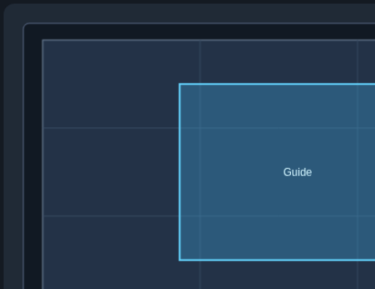

# MiniMax H3 Spatial Guide

Native-size image/video guides and a drag-to-position editor for ComfyUI's native MiniMax H3 model. No additional Python dependencies.



## Install

Place this repository in `ComfyUI/custom_nodes/ComfyUI-MiniMaxH3-SpatialGuide`, restart ComfyUI, and refresh the browser. Requires a ComfyUI version with native MiniMax H3 support. If installing by URL through Manager, use this repository's Git URL.

```bash
cd ComfyUI/custom_nodes
git clone https://github.com/meareabc/ComfyUI-MiniMaxH3-SpatialGuide.git
```

## Nodes

**Add Spatial Guide for MiniMax H3**

- Connect H3 `model`, `positive`, video `vae`, target AV `latent`, and guide frames `image`.
- The guide keeps its input dimensions. `x` and `y` locate its **top-left corner** in target pixels: positive x moves right, positive y moves down.
- Connect **both output MODEL and positive** to the sampler/guider. Connect the target latent directly to the sampler.
- For audio, chain a native Add Guide after this node with only its audio inputs connected.

**MiniMax H3 Guide Position**

- Set `guide_width`, `guide_height`, `canvas_width`, and `canvas_height`, or connect their INT inputs.
- Drag the blue guide rectangle; its size stays fixed. Hold Shift to snap movement to 32 pixels. Center and Origin buttons provide quick alignment.
- Connect its `x` and `y` outputs to Add Spatial Guide's corresponding inputs. Coordinates save with the workflow and can also be edited numerically.
- Linked Primitive values update the preview immediately. Dimensions computed by other backend nodes synchronize after execution; before the first run the preview uses the saved dimensions. Enter sizes directly for an exact preview before running.

For a 640×480 guide on a 960×480 canvas, `x=0,y=0` leaves 320 pixels to the right; `x=160,y=0` centers it. For a 480×640 guide on a 480×960 canvas, use `x=0,y=160` to center it vertically.

## Behavior and validation

Video guides follow native Add Guide's valid lengths: 5, 22, 39… frames; batches below 5 frames use the first image. Nonmultiples of 32 are padded at the right/bottom with replicated edges, without scaling. This is positional conditioning, so generated pixels can change inside the guide region.

CPU tests cover native-size coordinates, mixed guides/audio/references, clone isolation, registration, and a small native H3 forward. Full pretrained outpainting quality has not been validated.

```bash
python -m unittest discover -s custom_nodes/ComfyUI-MiniMaxH3-SpatialGuide/tests -v
```

## 中文使用说明

重启并刷新后搜索 **MiniMax H3 Guide Position**，输入参考宽高和目标画布宽高，在预览里拖动蓝框。输出的 `x/y` 接到 **Add Spatial Guide for MiniMax H3**；表示参考区域左上角坐标，原点在目标画布左上角。按住 Shift 拖动可按 32 像素对齐，也可点击居中或左上归零。

Spatial Guide 的 **MODEL 和 positive 两个输出都要连接到采样器**，目标 latent 直接接采样器。音频可用原生 Add Guide 单独添加。
